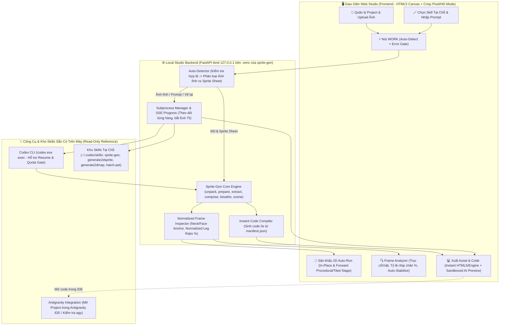

# 🎮 Kiến Trúc Chi Tiết (v2.0): **2D Sprite Auto-Run Studio**

> [!IMPORTANT]
> **Bản cập nhật v2.0 (Đã hiệu chỉnh toàn bộ theo phản hồi đánh giá kỹ thuật):**
> 1. **Sửa lỗi cú pháp & Chuẩn hóa toán học:** Sửa bảng Markdown ở Mục 4; thay ngưỡng pixel tuyệt đối bằng **tỷ lệ phần trăm chuẩn hóa theo kích thước nhân vật** với miền giá trị liên tục, kín 100% (`< 5%`, `5% – 35%`, `> 35%`).
> 2. **Thuật toán đo đầu chống nhiễu tóc:** Dùng đường thắt cổ (`neck_row` từ `sprite_gen.effects.breathe`) kết hợp cạnh mặt trước (`Leading Face Edge`) thay vì trọng tâm toàn bộ 25% đầu (tránh bị bím tóc đung đưa làm sai lệch).
> 3. **Làm rõ CLI & Bản quyền:** Gọi trực tiếp `codex.exe` và tham chiếu tại chỗ (`Read-only Reference`) tới `~/.codex/skills/` (Apache-2.0) thay vì sao chép; làm rõ vai trò của `Antigravity IDE` / `agy` tuân thủ đúng điều khoản `sprite-gen` (PR `#36`).
> 4. **Bảo mật & Chịu lỗi:** Server chỉ bind `127.0.0.1`, chạy thử code trong `<iframe sandbox="allow-scripts">`, bắt mã lỗi **Exit 75 (`codex-unavailable`)**, hỗ trợ resume từng hàng và tách rõ **Phase 1 (MVP)** vs **Phase 2 (Mở rộng)** kèm bộ test `pytest`.

---

## 1. Tổng Quan Hệ Thống (System Architecture)



---

## 2. Cấu Trúc Thư Mục Dự Án (`Directory Tree`)

Không sao chép trùng lặp bộ `sprite-gen` hay các skill sang thư mục mới (vừa tôn trọng giấy phép **Apache-2.0**, vừa tránh lệch `.venv`). Công cụ tham chiếu trực tiếp tới kho skill đã cài đặt sẵn và đặt tại:
`c:\Katsuragi_Shin\Aika 2D Sprite Tool\`

```text
Aika 2D Sprite Tool/
├── ARCHITECTURE.md                  # Tài liệu thiết kế kiến trúc v2.0
├── run_studio.bat                   # Khởi chạy FastAPI ở 127.0.0.1:8780 + Mở trình duyệt
├── requirements.txt                 # fastapi, uvicorn, python-multipart (chạy trên .venv của sprite-gen)
├── app/
│   ├── __init__.py
│   ├── main.py                      # FastAPI Server (chỉ bind 127.0.0.1) + API + SSE Progress Stream
│   ├── config.py                    # Cấu hình đường dẫn tới SPRITE_GEN_ROOT, codex.exe, ~/.codex/skills
│   │
│   ├── core/                        # LÕI XỬ LÝ ẢNH & PHÂN TÍCH CHUYỂN ĐỘNG
│   │   ├── detector.py              # Kiểm tra ảnh lỗi -> Phân loại Ảnh tĩnh (1x1) vs Sprite Sheet (MxN)
│   │   ├── pipeline_runner.py       # Gọi sprite-gen (unpack, prepare, gen-set, extract, compose, breathe)
│   │   ├── frame_analyzer.py        # Đo lệch trục cổ/mặt & tỷ lệ thay đổi chân chuẩn hóa theo %
│   │   └── auto_stabilizer.py       # Tính dx, dy khóa trục đầu & lọc frame trùng qua curation.json
│   │
│   ├── bridges/                     # KẾT NỐI CLI & QUẢN LÝ TIẾN TRÌNH DÀI
│   │   ├── skill_registry.py        # Quét Read-only SKILL.md từ ~/.codex/skills & ~/.gemini/config/skills
│   │   ├── codex_bridge.py          # Chạy codex.exe, báo tiến độ từng hàng qua SSE, bắt mã lỗi Exit 75
│   │   └── ide_bridge.py            # Kiểm tra agy CLI hoặc mở thẳng thư mục Project bằng antigravity-ide.cmd
│   │
│   ├── exporters/                   # BỘ XUẤT ASSET & SINH CODE
│   │   ├── asset_exporter.py        # Xuất PNG Atlas, GIF (In-place & Forward), Aseprite JSON
│   │   ├── template_codegen.py      # Xuất HTML5 Canvas độc lập, Phaser 3, Godot 4, Unity C#
│   │   └── ai_codegen.py            # Sinh code tùy chỉnh qua Codex CLI + Xem trước trong Sandbox Iframe
│   │
│   └── project_manager.py           # Quản lý Project trong thư mục projects/
│
├── projects/                        # THƯ MỤC LƯU PROJECT CỦA SHIN
│   └── jirai-neko-demo/             # Project mẫu (dùng làm Fixture kiểm thử tự động):
│       ├── project.json             # Trạng thái project, lịch sử chạy, thông số FPS/Scale
│       ├── inputs/                  # input_sheet.png (bản lệch đầu 4.5px), base_chibi.png & character_ref.jpg
│       ├── runs/                    # Chứa unpacked_run/ và codex_run/
│       └── exported_code/           # File HTML5 Canvas / Engine code xuất ra
│
├── tests/                           # BỘ KIỂM THỬ TỰ ĐỘNG (PYTEST)
│   ├── test_detector.py             # Kiểm tra nhận diện đúng ảnh tĩnh vs sprite sheet vs ảnh lỗi
│   ├── test_frame_analyzer.py       # Kiểm tra đo lệch đầu và tỷ lệ nhịp chân trên fixture jirai-neko-demo
│   └── test_codegen.py              # Kiểm tra xuất code HTML5 Canvas/Engines từ manifest.json
│
└── web/                             # GIAO DIỆN NGƯỜNG DÙNG (FRONTEND SPA)
    ├── index.html                   # Giao diện Studio 3 cột + Thanh Frame Timeline
    ├── css/
    │   └── studio.css               # Dark UI + CSS image-rendering: pixelated cho chế độ Pixel Art
    └── js/
        ├── app.js                   # Quản lý Project, nút WORK, lắng nghe SSE tiến trình & xử lý lỗi
        ├── stage_player.js          # Canvas 2D: Integer Zoom, Pixel/Smooth toggle, Procedural Parallax Stage
        ├── frame_inspector.js       # Hiển thị thẻ từng frame, cảnh báo màu (Đỏ/Vàng/Xanh), nút Auto-Stabilize
        └── code_panel.js            # Xem & tải code tức thì + Iframe Sandbox cô lập cho code tùy chỉnh
```
